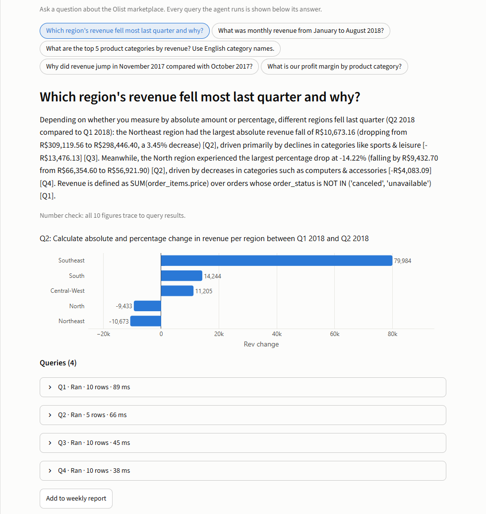
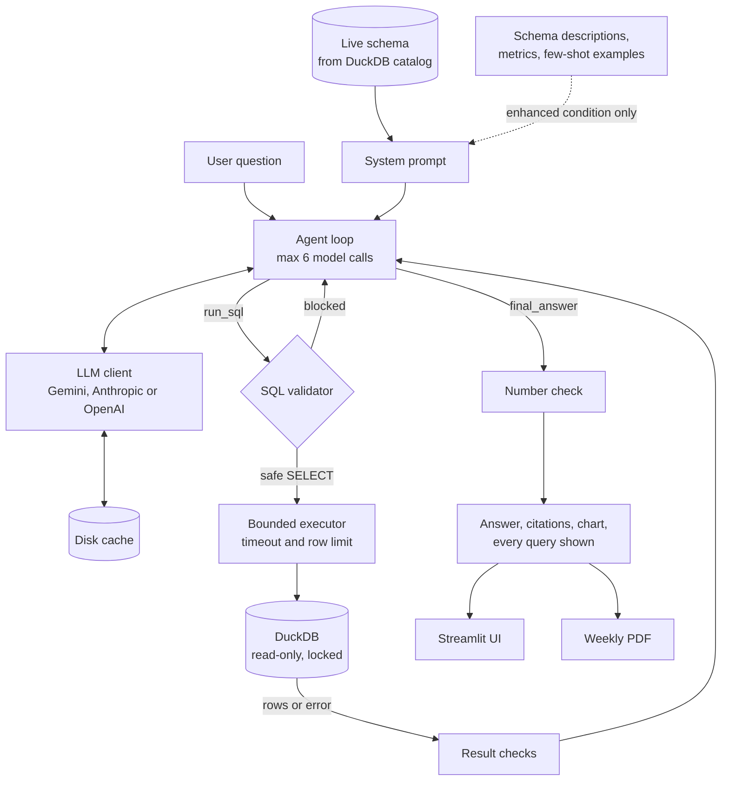

# Analytics Agent

A natural-language data analyst over a SQL database. Ask "which region's revenue fell most last quarter and why?" and it inspects the schema, writes SQL, runs it read-only, checks the results, retries on errors, and answers with a chart, citing the exact queries and numbers behind every claim.



## Problem

Business users have questions, and the answers sit in a database they cannot query. Connecting an LLM to that database raises three risks:

- **Safety.** Generated SQL must never change data or reach outside the database.
- **Silent errors.** A query can run perfectly and still be wrong. On this dataset, one natural join overstates revenue by 4.5%, and it raises no error.
- **Trust.** An answer nobody can check is worth little, so each number needs to trace back to a query.

This project addresses all three and measures how well it works on 30 questions with known answers.

## Approach

**Data.** The public [Olist e-commerce dataset](https://github.com/olist/work-at-olist-data): 99,441 orders from a Brazilian marketplace, 2016 to 2018 (MIT licence), loaded into DuckDB from a pinned commit. I added a table mapping the 27 states to Brazil's 5 official regions.

**Agent.** A bounded tool-calling loop, capped at 6 model calls per question. The model calls `run_sql` as often as it needs, sees each result or error, and finishes with `final_answer`. The schema comes live from DuckDB's catalog, so the prompt cannot drift from the data.

**Guardrails.** Three independent layers:

| Layer | What it does |
|---|---|
| SQL validator | Allow-list via `sqlglot`: one `SELECT` over known tables. No DDL, DML, `COPY`, `ATTACH`, `SET` or file-reading functions. Anything unparseable is refused. |
| Connection | `read_only=True`, `enable_external_access=false`, and `lock_configuration=true`, so a query cannot re-enable access. |
| Execution | 10-second timeout enforced by a watchdog, 1 GB memory limit, 1,000 rows kept, 50 rows shown to the model. |

**Answers people can check.** Every answer cites its queries as `[Q1]`. A deterministic number check, using no API calls, confirms each figure in the answer appears in a query result or can be calculated from one, and the UI flags any that cannot. "Why" answers name drivers visible in the data and do not claim proven causes.

**Weekly PDF.** Fixed KPI queries, week-over-week changes, any answers you pinned, and an appendix listing every query. See the [sample report](results/sample_weekly_report.pdf). The one LLM-written paragraph is discarded in favour of a template if it fails the number check.

## Architecture



## Results

All figures below come from real runs: `gemini-3.5-flash-lite`, one run at temperature 0, 201 API calls. Full traces are in [results/eval_live.json](results/eval_live.json), and the table for each question is in [results/eval_live.md](results/eval_live.md).

| Metric | Plain prompt | Descriptions + few-shot |
|---|---|---|
| Query ran without failing (of 27) | 27 (100%) | 27 (100%) |
| **Execution accuracy** (result matches gold, of 27) | 18 (67%) | **25 (93%)** |
| 95% interval | 48-81% | 77-98% |
| **Answer accuracy** (all 30) | 20 (67%) | **27 (90%)** |
| 95% interval | 49-81% | 74-97% |
| Average model calls per question | 3.70 | 3.00 |
| Figures not traced to a query result | 3 of 150 | 0 of 168 |

| Answer accuracy by tier | Plain prompt | Descriptions + few-shot |
|---|---|---|
| Easy (10) | 9 | 10 |
| Medium (11) | 6 | 10 |
| Hard (6) | 2 | 4 |
| Unanswerable (3) | 3 | 3 |

The paired comparison favours the enhanced prompt on both measures. On execution, 7 questions were correct only with it and 0 only with the plain prompt (exact McNemar p = 0.016). On answers, it was 8 against 1 (p = 0.039).

**What this does and does not show:**

- **The gain is business knowledge, not SQL skill.** Plain-prompt SQL always ran. All 8 enhanced-only answer wins came from definitions it was never given: what counts as revenue (E03, M02, M03, M08, H05), what counts as late (H02, H03), and averaging reviews per order (M11). Running is not the same as being right, which is the main lesson here.
- **Enhanced is not strictly better.** On H06 only the plain prompt drilled down to Black Friday, 24 November 2017, which was R$152,654 of that month's revenue.
- **M06 failed under both prompts.** Estimated delivery dates sit at midnight, so comparing timestamps counts same-day deliveries as late: 9.37% against the correct 7.73%. The enhanced prompt contained the right definition and the model ignored it.
- **The flagship question counts as a miss under the enhanced prompt, and I left it that way.** Its answer is correct and reports both readings (North −14.22%, Northeast −R$10,673.16), but it explains the fall by category, and the rubric, fixed before the run, also required the order counts. Loosening a rubric after seeing the score would be tuning the result.
- **All 15 blocked queries were harmless.** They were the model trying to browse the catalog on U01 and U02. No legitimate data query was refused, and no write was attempted in the evaluation.

**Guardrails.** 185 automated tests pass. They include 38 attacks refused by the full path and 12 raw statements sent straight to the connection, bypassing the validator, which it also refused.

**Gold answers.** Each of the 27 answerable questions was derived twice, in SQL and separately in pandas from the raw CSVs, with no shared code, and all 27 agree ([results/gold_verification.md](results/gold_verification.md)). These answers are independently double-derived. A person has not reviewed them.

## How to run

Requires Python 3.12. Chrome is needed to draw the charts in the PDF.

```bash
python -m venv .venv
.venv\Scripts\activate            # Linux or macOS: source .venv/bin/activate
pip install -r requirements.txt
cp .env.example .env              # add a key, or skip this and use --mock
python scripts/build_db.py        # downloads the data, builds data/olist.duckdb
```

```bash
# No API calls
streamlit run app.py -- --mock
python -m analytics_agent.cli ask "Which region's revenue fell most last quarter and why?" --mock
python -m analytics_agent.cli report --week 2018-08-13 --mock
python -m eval.run_eval --mock    # tests the pipeline only; says nothing about model accuracy
python -m eval.verify_gold        # re-derives the gold answers
pytest

# Live: uses LLM_PROVIDER from .env (gemini, anthropic or openai)
streamlit run app.py
python -m analytics_agent.cli ask "What was the average order value in Q2 2018?"
python -m eval.run_eval --live                 # prints the API budget and stops
python -m eval.run_eval --live --confirm-api   # runs it, up to 360 calls
```

Every LLM reply is cached in `.cache/llm/`. Set `LLM_CACHE_ONLY=1` to replay saved replies with no chance of a paid call.

## Limitations

- **One model, one dataset, one run.** With 30 questions the intervals are wide, and results may not transfer to other models or schemas.
- **The evaluation is not fully held out.** I ran the flagship question once before the evaluation, and it exposed a date bug: the model treated unfinished Q3 2018 as "last quarter". The fix went into the instructions shared by both prompts, and it also affects M10 and U02.
- **Some gold answers rest on project definitions**, such as revenue excluding freight. The plain prompt is scored against definitions it never saw, which is the point of the comparison, but it also means the gap measures missing context rather than model ability.
- **Execution accuracy is deliberately lenient.** A question passes if any query in the trace matches gold, and extra rows and columns are allowed. Plain M03 passed execution yet gave a wrong final answer, which is why both measures are reported.
- **"Why" answers show association, not cause.** The data reveals what moved, not why it moved.
- **The number check can be fooled.** It proves a figure exists in a result, not that the sentence around it is right. It can also raise false alarms on rounding: plain H03's `1.7272248` was flagged only for its excess precision.
- **Anthropic and OpenAI are tested with fake clients only.** Only Gemini has been run live.
- **The guard is strict.** `PIVOT`, `VALUES` and table functions such as `generate_series` are refused, so the agent has to rewrite those queries.
- **Dates are fixed.** The data ends in 2018, so "today" is pinned to 2018-08-31 in `analytics_agent/config.py`. A live database would use the real date.
- **Unanswerable questions waste calls.** The model spent 6 calls on U01 and U02, mostly on blocked catalog lookups, before declining correctly.
